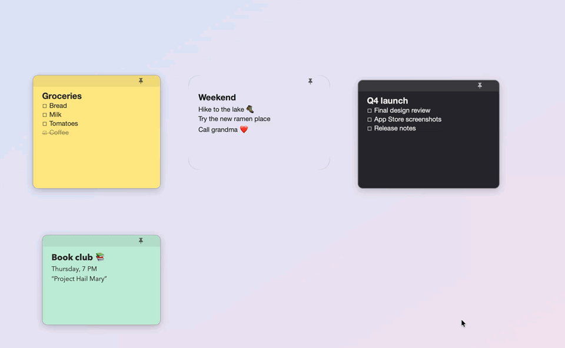

# Foglietti

Customizable sticky notes for macOS: colors, fonts, Liquid Glass, themes, reminders, emoji, translation and an assistant powered by Apple Intelligence. It's a native, lightweight app (about 20 MB of memory) and everything stays on your Mac.

The interface is in English, and in Italian when the Mac's language is Italian.



## Features

**Notes**
- Borderless, resizable notes on your desktop. Double-click the bar to collapse a note to a strip.
- Pin a note on top of other apps 📌, or show it on all desktops.
- Rich text: bold, italic, strikethrough, highlight, headings, links.
- Clickable ☐ checkboxes, and lists that continue when you press Return.
- Images and screenshots: drag them in, paste them, or capture with ⇧⌘I. They fit the note's width; double-click one to open it in Preview.
- Emoji picker with categories, recent emoji and your own set.

**Customization** (🎨 on every note)
- Any background, text and bar color. Opacity, font, size, line spacing, margins, corners, border, shadow.
- Solid, **Liquid Glass** (macOS 26+), clear glass or blurred surface.
- 14 built-in themes, plus your own: create, edit, export and import them.

**Organization**
- Note list with search, archive and trash. The trash empties itself after 30 days, or after the number of days you choose.
- Reminders 🔔: the note comes back in front of other apps and you get a notification.
- **Sounds**: pick any system sound or your own audio file, per note too. Set the volume, repeat until you touch the note, have the title read aloud, mark reminders as Important, and set quiet hours. Optional interface sounds.
- Sync between Macs through iCloud Drive. Notes are merged one by one and the most recent change wins.

**Getting started**
- A welcome window on first launch explains each permission (notifications, open at login, Apple Intelligence, screen recording) with a button to grant it and a live ✓ status. Nothing is asked before you choose.
- Settings with a sidebar, like System Settings.
- Update check: Foglietti looks at this repository's releases once a day and tells you when a new version is out (Download / Later / Skip This Version). It can be turned off.

**Sharing**
- Formatted email (⇧⌘M), WhatsApp with formatting converted (⌃⌘W), and the system Share menu.
- Export and import of .txt, .md, .rtf and .rtfd files.

**On-device intelligence**
- ✨ Apple Intelligence (⌘J): summarize, proofread, rewrite, change tone, turn into a checklist, keep writing, or give a custom instruction (⇧⌘J). The menu actions are editable in Settings.
- **Find reminder in text** spots phrases like "Thursday at 5:30 PM" and offers to set the reminder.
- **Ask Foglietti** (⌃⌥Space from any app): "remind me tomorrow at 9 to…", "what reminders do I have?", "what does the note about… say?".
- 🌐 Translation with Apple Translate (⌥⌘T): 20 languages, automatic source-language detection, works offline.

## Requirements

- macOS 14 or later.
- Translation needs macOS 15+. Liquid Glass and Apple Intelligence need macOS 26+ on an Apple silicon Mac with Apple Intelligence turned on.
- To build it, the Xcode Command Line Tools are enough (Swift 5.10+): `xcode-select --install`.

## Build and install

```bash
./build.sh            # creates build/Foglietti.app
./build.sh install    # also copies it to /Applications
```

The build gets a local (ad-hoc) signature, so it runs on the Mac where you build it. To distribute it, sign it with a Developer ID and notarize it.

On first launch a welcome window lets you turn on notifications and open at login. You can reopen it from the Foglietti menu → Welcome…

## Main shortcuts

| Action | Keys |
|---|---|
| New note (from any app) | ⌃⌥N (configurable) |
| Ask Foglietti (from any app) | ⌃⌥Space |
| AI actions / custom instruction | ⌘J / ⇧⌘J |
| Translate | ⌥⌘T |
| Emoji | ⌃⌘E |
| Insert screenshot | ⇧⌘I |
| Checkbox | ⇧⌘L |
| Title / Subtitle / Body | ⌘1 / ⌘2 / ⌘0 |
| Send by email / WhatsApp | ⇧⌘M / ⌃⌘W |

The full list is in Settings → Shortcuts.

## Data and privacy

- Notes are stored in `~/Library/Application Support/Foglietti/foglietti.json`, or in iCloud Drive if you turn on sync. The file is readable JSON, and the text is stored as RTFD so it keeps formatting and images.
- A backup copy, `foglietti.backup.json`, is made at every launch.
- Apple Intelligence and Apple Translate run on the Mac: the text of your notes is never sent to any server.
- The update check only reads the public release list of this repository on GitHub, once a day; it sends no data about you or your notes, and it can be turned off in Settings → About & Updates.

## Localization

English is the base language: the English text is the key. Translations live in `Resources/<language>.lproj/Localizable.strings`; Italian is in `Resources/it.lproj`. To add a language, copy that file into a new `xx.lproj` folder, translate the values, and add the code to `CFBundleLocalizations` in `Resources/Info.plist`.

## Code layout

| File | Contents |
|---|---|
| `Model.swift` | Notes, styles, themes, preferences |
| `Store.swift` | Saving, backups, iCloud Drive sync |
| `NotesManager.swift` | Open windows, trash |
| `NoteWindow.swift`, `NoteTextView.swift` | Note window, editor, images |
| `StyleViews.swift`, `ListAndSettings.swift` | Style panel, note list, settings |
| `Reminders.swift`, `Sounds.swift` | Reminders, notifications and sounds |
| `AIEngine.swift`, `AIPanels.swift` | Apple Intelligence |
| `Translator.swift` | Apple Translate |
| `Emailer.swift`, `WhatsApp.swift` | Sharing |
| `EmojiPicker.swift`, `HotKey.swift` | Emoji, global shortcuts |
| `Onboarding.swift`, `UpdateChecker.swift` | Welcome window, update check |
| `Localization.swift` | `L()` helper for localized text |

To try the assistant from the terminal: `.build/release/Foglietti --ask "what reminders do I have?"`

## License

MIT: see [LICENSE](LICENSE).
